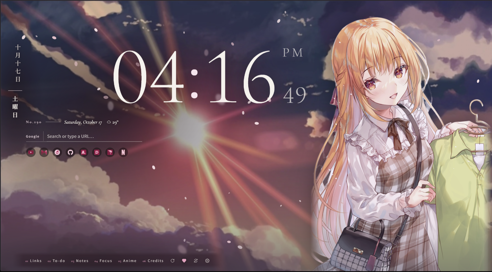
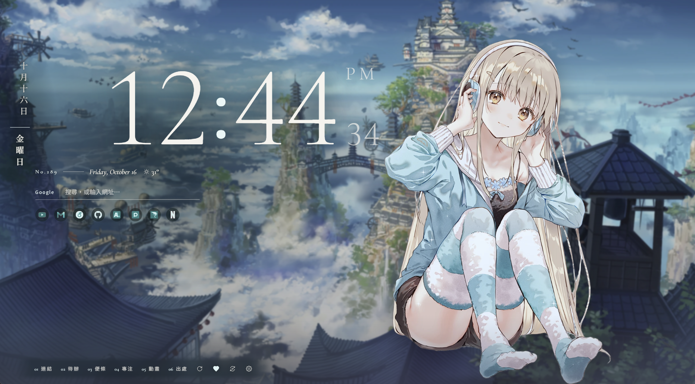

<!-- prettier-ignore -->
<div align="center">


# Tab Prettier

*每次開新分頁，都是一幅新的動漫合成畫：場景與角色在景深裡分層*

<a href="https://chromewebstore.google.com/detail/fnacfhfopcdcgidgjllgngoigaajbapi">
    
</a>

[](https://chromewebstore.google.com/detail/fnacfhfopcdcgidgjllgngoigaajbapi)
[](https://developer.chrome.com/docs/extensions/develop/migrate/what-is-mv3)
[](https://www.typescriptlang.org)
[](https://preactjs.com)
[](https://onnxruntime.ai)
[](LICENSE)
[](https://kuanhsun.pages.dev/support?lang=zh-TW)

[實際畫面](#實際畫面) • [功能](#功能) • [運作方式](#運作方式) • [開始使用](#開始使用) • [怎麼操作](#怎麼操作) • [常見問題](#常見問題)

[English](README.md) · 繁體中文

</div>

Tab Prettier 把 Chrome 的新分頁換成一幅當場合成的畫：一張場景當背景，一位動漫角色自動去背站在前面，
時鐘夾在兩者之間。滑鼠一動，畫面就跟著景深移動。

畫面周圍是新分頁本來該有的東西：搜尋、常用連結、待辦、專注計時、今天播出的番。它們都盡量安靜，讓畫面當主角。

> [!TIP]
> 角色去背和景深估算都**在你自己的電腦上**進行。圖片不會上傳到任何地方，擴充功能背後也沒有帳號或伺服器。

---

## 實際畫面

<!-- prettier-ignore -->
<div align="center">
  
  <br /><br />
  
</div>

---

## 功能

**畫面**

- **合成，而不是挑一張圖**：場景和角色分開挑選，再去背、調色、依場景光源補輪廓光，每次都不一樣
- **景深視差**：背景依深度分層，跟著滑鼠移動；角色會輕輕呼吸
- **跟著時段與天氣**：清晨、黃昏、夜晚有不同的場景；你那裡真的下雨、下雪時，畫面也會有雨、雪和遠景霧氣
- **構圖開關**：只要特寫、只要遠景，或沒有角色的純風景；也可以排除不想看到的標籤
- **收藏或隱藏**：喜歡的畫面收藏起來、匯出成桌布；不喜歡的按一下就不再出現
- **自己的圖片**：上傳圖片，或指定電腦裡的資料夾

**追番**

- **AniList**：登入後，你清單裡的作品角色會出現在新分頁
- **今日壽星**：今天生日的角色會特別登場
- **番劇面板**：今天播出與本季新番，不用登入

**新分頁工具**

- **時鐘與天氣**
- **搜尋框**：像網址列一樣的建議，包含你去過的網站和已經開著的分頁
- **連結**：常用連結（雙色調圖示）、最近關閉的分頁、常去網站
- **待辦與便條**：跟著 Chrome 設定檔同步
- **專注計時**：時鐘變成倒數；專注時打開你列出的分心網站，會收到溫和的提醒
- **不讓筆電發燙**：效能等級、省電模式，背景動態也盡量用最低的更新率

---

## 運作方式

新分頁必須瞬間打開，但去背和估算景深要好幾秒。所以這些工作都在背景先做好，新分頁只顯示已經完成的畫面：

```
背景程式：每 30 分鐘，或可用畫面快用完時
 │
 ├─► 抓一張場景圖 ──────────► 景深圖（Depth Anything V2）
 │                              │
 ├─► 抓一張角色圖 ──────────► 去背（anime-segmentation）
 │                              │  精修遮罩邊緣
 │                              │  依場景調整角色色調
 │                              │  依場景光源補輪廓光
 │                              ▼
 └──────────────────────────► 構圖：角色站哪裡、時鐘放哪裡、哪一側比較亮
                                │
                                ▼
                        已完成的畫面（存在你的電腦上）
                                │
新分頁 ◄────────────────────────┘  六層：背景、時鐘、角色、霧、粒子、工具
```

兩個模型都用 ONNX Runtime Web 在瀏覽器裡執行：支援 WebGPU 時用顯示卡，否則用 CPU。效能較低的電腦會等閒置時才在背景處理。

---

## 開始使用

到 **[Chrome 線上應用程式商店](https://chromewebstore.google.com/detail/fnacfhfopcdcgidgjllgngoigaajbapi)** 安裝，然後開一個新分頁。
第一幅畫面要等 10～30 秒準備第一批圖片，之後每次開新分頁都是秒開。

<details>
<summary><b>或自己建置</b></summary>

```bash
git clone https://github.com/ChiuKuanHsun/Tab-prettier.git && cd Tab-prettier
npm install
npm run build        # 產出 dist/
```

打開 `chrome://extensions`，開啟右上角的「開發人員模式」，按「載入未封裝項目」選 `dist/`。
開發時可以用 `npm run dev`，每次存檔自動重新建置，到擴充功能頁按重新載入即可。

`npm test` 執行單元測試；`npm run package` 會建置並把 `dist/` 打包成上架用的 zip。

**Firefox**（140 以上）：`npm run build:firefox` 產出 `dist-firefox/`，程式相同、只換成 Firefox 的
manifest。打開 `about:debugging#/runtime/this-firefox`，按「載入暫用附加元件」選 `dist-firefox/manifest.json`；
`npm run package:firefox` 會打包成上架 addons.mozilla.org 用的 zip。Firefox 沒有 offscreen 文件，
由背景頁自己執行合成畫面的 worker；不能選資料夾當來源，固定連結顯示網站自己的圖示、不套用主題色。

**從原始碼重建 Firefox 套件**（給附加元件審核員）：只需要 Node.js 22 或 24 和 npm，任何作業系統都可以。在原始碼資料夾執行

```bash
npm ci
npm run build:firefox
```

產出的 `dist-firefox/` 就是上傳的套件，每個檔案都相同。`public/models/` 的兩個 ONNX 模型是第三方的權重檔，原樣放入（見下方致謝；anime-seg 模型用 `tools/convert_model.py` 轉成 fp16）。`npm run package:source` 會把目前的提交打包成原始碼 zip。

**Edge**：直接用 Chrome 版。打開 `edge://extensions`，開啟「開發人員模式」，按「載入解壓縮」選 `dist/`；
`npm run package` 產出的 zip 也可以直接上傳到 Microsoft Partner Center。Edge 第一次可能會詢問是否保留擴充功能的新分頁。

| 部分 | 位置 | 說明 |
|---|---|---|
| 新分頁 | `src/newtab/` | 從 IndexedDB 取已完成的畫面，渲染六個圖層 |
| Service worker | `src/background/` | 排程補充畫面（alarms、閒置偵測），管理 offscreen document |
| Offscreen | `src/offscreen/` | 在 Web Worker 裡執行，開著的新分頁才不會卡：抓圖 → 去背（WebGPU，失敗時改用 WASM）→ 精修遮罩 → 色調轉移 → 輪廓光 → 構圖分析 |
| 純演算法 | `src/lib/compose.ts`、`src/offscreen/{refine,harmonize}.ts`、`src/lib/palette.ts` | 有單元測試 |
| 設定頁 | `src/options/` | 設定頁 |

去背模型用 `tools/convert_model.py` 轉成 fp16。

</details>

---

## 怎麼操作

| 按鍵 | 作用 |
|---|---|
| `/` | 聚焦搜尋框 |
| `Alt+1` … `Alt+6` | 開關 連結／待辦／便條／專注／番劇／出處 面板 |
| `Esc` | 關閉目前的面板 |

- **設定**：新分頁 Dock 上的齒輪（或 `chrome://extensions` 的「詳細資料 → 擴充功能選項」）。主題、圖源、
  構圖、動態、效能、上傳、收藏、AniList、備份都在這裡，頁首有使用說明的連結。
- **出處**：出處面板會列出目前圖片的來源和標籤，並連到原始頁面。
- **選用功能會先詢問**：最近關閉的分頁、常去網站、搜尋建議、專注時的提醒，都是在你開啟時才要求權限。

### AniList

今日播出與本季新番不用登入。要使用你自己的清單，到設定頁的 AniList 區塊，照步驟建立 AniList API Client；
要填的 Redirect URL 會顯示在那一頁。

### 分頁列主題（選用）

Chrome 只允許另外的「佈景主題」改分頁列的顏色，而且佈景主題不能包含程式。`chrome-themes/` 裡有三個對應新分頁主題的配色：
`editorial`、`dreamy`、`neon`，到 `chrome://extensions` →「載入未封裝項目」選其中一個即可。

---

## 常見問題

**圖片會上傳嗎？**
不會。圖片從下面列出的圖源下載後，在你的電腦上處理。

**為什麼擴充功能這麼大？**
去背（88 MB）和景深（50 MB）兩個模型直接包在裡面，之後不用再另外下載任何東西。

**電腦會發燙嗎？**
背景動態只用必要的最低更新率。如果還是覺得熱，可以在設定關閉粒子效果，或把效能等級改成省電。

**可以指定出現的角色嗎？**
可以：設定喜歡的角色、使用 AniList 清單裡的角色，或排除不想看到的標籤。

**會有成人內容嗎？**
不會。每個圖源都只取最安全的分級，成人標籤也固定排除。

---

## 隱私

- 圖片在你的電腦上處理，不會上傳，開發者也沒有伺服器
- 設定、連結、待辦、便條存在 Chrome 裡（開啟 Chrome 同步時跟著你的設定檔同步）
- 部分功能會直接從你的瀏覽器連到外部服務：圖源、天氣用的 Open-Meteo、搜尋建議用的 Google、登入時的 AniList

完整內容：**[隱私權政策](https://chiukuanhsun.github.io/Tab-prettier/)**

---

## 使用的技術

| | 用途 | 授權 |
|---|---|---|
| SkyTNT 的 [anime-segmentation](https://github.com/SkyTNT/anime-segmentation) | 角色去背（fp16） | Apache-2.0 |
| [Depth Anything V2 Small](https://huggingface.co/onnx-community/depth-anything-v2-small) | 景深圖（fp16） | Apache-2.0 |
| [ONNX Runtime Web](https://github.com/microsoft/onnxruntime) | 瀏覽器內推論 | MIT |
| [Preact](https://preactjs.com) | 介面 | MIT |
| [Cormorant Garamond](https://fonts.google.com/specimen/Cormorant+Garamond)、[Shippori Mincho](https://fonts.google.com/specimen/Shippori+Mincho) | 字型 | OFL-1.1 |

圖片來自 [Wallhaven](https://wallhaven.cc)、[Danbooru](https://danbooru.donmai.us)（只取全年齡分級）、
[Nekosia](https://nekosia.cat)、[waifu.im](https://waifu.im)；天氣來自 [Open-Meteo](https://open-meteo.com)；
番劇資料來自 [AniList](https://anilist.co)。

> [!NOTE]
> Depth Anything V2 只有 **Small** 版是 Apache-2.0，Base 和 Large 是非商用授權，不能替換。

---

## 支持開發

如果 Tab Prettier 讓你的新分頁好看了一點，歡迎**[請作者喝杯咖啡](https://kuanhsun.pages.dev/support?lang=zh-TW)**。
問題回報和功能建議請到 [Issues](https://github.com/ChiuKuanHsun/Tab-prettier/issues)。

---

## 免責聲明

Tab Prettier 本身不含任何圖片。圖片從上面列出的公開圖庫取得，著作權屬於原作者；出處面板會連到每張圖的來源。
Tab Prettier 與這些網站及 AniList 都沒有任何關係。

---

## 授權

Tab Prettier 採用 [GNU 通用公共授權條款第 3 版（GPL-3.0）](LICENSE)。你可以使用、研究、修改和散布；
散布以它為基礎的作品時，也必須以 GPL-3.0 釋出並附上原始碼。

上面列出的第三方元件依各自的授權條款。兩個模型是 Apache-2.0，可以納入 GPL-3.0 的作品；重新散布時請保留它們的出處標示。
